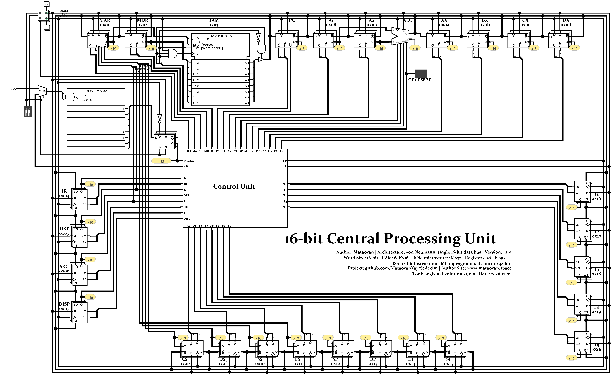

# Sedecim

> *Sedecim* is a **16-bit microcoded CPU** designed and built from the gate level up in **Logisim-Evolution**, together with a small Python toolchain that defines its instruction set and compiles programs to machine code.



The CPU follows an **x86-inspired** design: a 16-bit data path, a register file with `AX/BX/CX/DX`, a four-segment memory model (`CS/DS/SS/ES`) and a stack pointer (`SP/BP`), driven by a microcode ROM. Every instruction is implemented as a sequence of 32-bit **microinstructions** that orchestrate the bus, the ALU, the register file and the memory — making the whole design transparent, educational and easy to extend.

---

## Features

- **16-bit data path** with a shared internal bus and a 16-bit main memory (64 Ki × 16-bit address space).
- **Microcoded control unit**: instructions are decoded through a 2<sup>20</sup> × 32-bit microcode ROM, so the ISA is defined entirely in software (`ISA.py`) rather than hard-wired.
- **x86-inspired architecture**: 12 architectural registers (`AX`, `BX`, `CX`, `DX`, `CS`, `DS`, `SS`, `ES`, `SP`, `BP`, `DI`, `SI`, `T1`-`T5`) and a segmented memory model.
- **33 instructions** across data transfer, arithmetic, logic, shifts, stack, subroutine and conditional control flow.
- **6 addressing modes**: immediate (`10`), register (`AX`), direct (`[10]`), indirect (`[AX]`), register+offset (`[BP+1]`) and base+index (`[BP+SI]`).
- **16-operation ALU** provides 16 operations `ADD`, `SUB`, `INC`, `DEC`, `AND`, `OR`, `XOR`, `NAND`, `NOR`, `XNOR`, `NOT`, `SHL`, `SHR`, `SAR`, `PA` and `PB` with a 4-bit program-status word (`ZF`/`SF`/`CF`/`OF` flags).
- **Pure-gate implementation**: no built-in CPU — everything (registers, ALU, multiplexers, decoders, flip-flops) is assembled from primitive gates, only ROM and RAM use Logisim memory components for data editing purposes.
- **Python toolchain** (standard library only): an ISA/microcode definition and a compiler that both *generates the microcode image* and *assembles programs*.

---

## Demonstration
The following demonstrates the process of executing a multiplication function call using its own ISA instruction set:

https://github.com/user-attachments/assets/4a86cf8b-ae91-47c2-b964-e9d5582b77e7

---

## Project layout

```
16-bit CPU/
├── 16-bit CPU.circ     # Logisim-Evolution circuit
├── ISA.py              # instruction set & microcode definition
├── COMPILER.py         # microcode compiler + assembler
├── microcode.raw       # generated microcode image
├── Demo.ipynb          # usage examples
└── README.md
```

---
## Architecture overview

```
                     +-------------------------------------------------------------------+
                 addr|                            Microcode ROM                          |
                 +--->                        (2^20 words x 32-bit)                      |
                 |   +---------------------------------+---------------------------------+
 IR<<8|PSW<<4|CYC|                                     |MICRO
                 |   +---------------------------------v---------------------------------+
                 |   |                                                                   |
                 +---<                            CONTROL UNIT                           <----+
                     |                                                                   |    |
                     +-----^-+-------------------+-----------------+--------------^-+----+    |
            IR,DST,SRC,DISP| |CS,WE,SC           |CS,WE            |CS,WE,CT   PSW| |OP,AO,PO |
                     +-----+-v-----+     +-------v-------+    +----v----+    +----+-v----+    |
                     |  Reg. File  |-MAR->    Main RAM   |    | Program |    |    ALU    |    |
                     |  (26 words) |-MDR-> 64 Ki x 16-bit|    | Counter |    |  (16 ops) |    |
                     +-----+-v-----+     +------+-v------+    +---+-v---+    +----+-v----+    |
   +------------+          | |                  | |               | |             | |         |
   |   PULSE    |CP/R      | +------------------|-+---------------|-+-------------|-+---BUS   |
   | CONTROLLER >----------+--------------------+-----------------+---------------+-----------+
   +------------+
```

- **Microcode ROM** stores 2^20 32-bit microcode and is addressed by the concatenation of the 12-bit IR, 4-bit PSW, and 4-bit CYC.
- **Control unit** reads the current microinstruction from the ROM and drives the data path.
- **Pulse controller** provides a global pulse and reset signal and accepts a halt signal; Manual mode (`MAN`) generates a pulse manually via the `CP` button (with `RS` for reset).
- **The program counter** indicates the index of the current code in the code segment.
- **ALU (Arithmetic Logic Unit)** provides 16 operations: `ADD`, `SUB`, `INC`, `DEC`, `AND`,`OR`, `XOR`, `NAND`, `NOR`, `XNOR`, `NOT`, `SHL`, `SHR`, `SAR`, `PA` and `PB`. The operands are passed in from registers `A1` and `A2`.
- **MAR (Memory Address Register)** is shifted by `SC (Segment Control)` among `CS (Code Segment)`, `DS (Data Segment)`, `SS (Stack Segment)`, and `ES (Extra Segment)`; in addition, the `BP (Base Pointer)` and `SI (Stack Index)` registers are hard-wired to select the `SS` shift by default.

---

## Register file

The register file is a 26-word, 16-bit structure indexed by a *pin address* (see `PIN` in `ISA.py`). The registers visible to the programmer are:

| Group          | Registers                        | Role                       |
|----------------|----------------------------------|----------------------------|
| General        | `AX`, `BX`, `CX`, `DX`           | Accumulator / general data |
| Segment        | `CS`, `DS`, `SS`, `ES`           | Code / data / stack / extra|
| Pointer        | `SP`, `BP`                       | Stack pointer / base pointer|
| Index          | `SI`, `DI`                       | Source / destination index |
| Cache | `T1`, `T2`, `T3`, `T4`, `T5` | Temporaries |

The remaining entries are internal (microarchitectural) registers such as `MAR`, `MDR`, `IR`, `DST`, `SRC`, `DISP` , and the two ALU inputs, `A1` and `A2`.

---

## Instruction set

33 mnemonics are defined:

| Category         | Mnemonics                                          |
| ---------------- | -------------------------------------------------- |
| Data transfer    | `MOV`                                              |
| Arithmetic       | `ADD`, `SUB`, `CMP`, `INC`, `DEC`                  |
| Logic            | `AND`, `OR`, `XOR`, `NAND`, `NOR`, `XNOR`, `NOT`   |
| Shift            | `SHL`, `SHR`, `SAR`                                |
| ALU pass-through | `PA`, `PB`                                         |
| Unconditional    | `JMP`                                              |
| Conditional      | `JZ`, `JNZ`, `JS`, `JNS`, `JC`, `JNC`, `JO`, `JNO` |
| Subroutine       | `CALL`, `RET`                                      |
| Stack            | `PUSH`, `POP`                                      |
| Misc             | `NOP`, `HLT`                                       |

Conditional jumps are evaluated against the 4-bit **program-status word**:

| Flag | Bit  | Meaning            | Jump when set / clear |
| ---- | ---- | ------------------ | --------------------- |
| `ZF` | 0    | Zero               | `JZ` / `JNZ`          |
| `SF` | 1    | Negative sign      | `JS` / `JNS`          |
| `CF` | 2    | Unsigned carry out | `JC` / `JNC`          |
| `OF` | 3    | Signed overflow    | `JO` / `JNO`          |

The conditional jumps use a clever trick: when the PSW does **not** satisfy the branch condition, the microcode slot is filled with a `FETCH1` sequence padded with `CYC` (the “PSW cavity”), so the CPU simply skips the target operand and falls through to the next instruction.

---

## Addressing modes

| Mode | Syntax          | Meaning                             |
| ---- | --------------- | ----------------------------------- |
| IMM  | `10`, `0x10`    | Immediate value                     |
| REG  | `AX`            | Register                            |
| DIR  | `[5]`, `[0x10]` | Direct — absolute address           |
| IND  | `[BP]`          | Indirect — address held in register |
| ROF  | `[BP+1]`        | Register + offset                   |
| BIX  | `[BP+SI]`       | Base + index                        |

Examples:

```asm
MOV AX 0x10        ; AX = 0x10
ADD AX BX          ; AX = AX + BX
MOV [5] AX         ; store AX at address 5 of the data segment
MOV AX [BP]        ; load AX from address in BP of the stack segment
INC [0x8000]       ; increment the word at 0x8000
```

---

## Microcode

Control is **microprogrammed**: every machine instruction in Microcode ROM is a list of 32-bit microinstructions (`MICROINSTRUCTION` in `ISA.py`), where each control field is as follows:

| bit   | Microcode                        | Meaning                                                      |
| ----- | -------------------------------- | ------------------------------------------------------------ |
| 0~4   | Register Addressing Read         | Enable the `CS` signal of the corresponding register only.   |
| 5~9   | Register Addressing Write        | Enable the `CS`, and `WE` signals of the corresponding register. |
| 10~12 | DST Read, SRC Read, DISP Read,   | Read according to 0~4 bits when all are zero; at most one bit can be enabled to read using the word in the Destination/Source/Displacement register. |
| 12~15 | DST Write, SRC Write, DISP Write | Write according to 0~4 bits when all are zero; at most one bit can be enabled to write using the word in the Destination/Source/Displacement register. |
| 16~17 | Segment Shift Select             | Select segment manually: `00`-`CS`, `01`-`DS`, `10`-`SS`, `11`-`ES`. |
| 18~19 | Segment Shift Mode Select        | `00`: Use code segment by default; `01`: Determine based on the word in Destination register; `10`: Determine based on the word in Source register; `11`: Select segment manually. |
| 20~21 | PC WE/CS                         | The `WE`,`CS` signals of the program counter.                |
| 22    | PC CT                            | The `CT` signal of the program counter, which enables the program counter to increment on every clock pulse. |
| 23~26 | ALU Opcode                       | Opcodes of Arithmetic Logic Unit.                            |
| 27    | ALU Out                          | Output the result of Arithmetic Logic Unit to the bus.       |
| 28    | PSW Out                          | Update program state word register.                          |
| 29    | Empty                            | -                                                            |
| 30    | Recycle                          | Reset microcode list cycle.                                  |
| 31    | Halt                             | Send halt signal to Pulse Controller.                        |

- **Fetch sequences** `FETCH0`–`FETCH3` read the opcode word and 0–2 operand words.
- Each instruction is **padded to 16 cycles** with the `CYC` (cycle-reset) control.
- The microcode ROM is addressed by the concatenation of:

  ```
  [ 12-bit instruction word ][ 4-bit PSW ][ 4-bit cycle counter ]
  ```

  yielding a 20-bit address (1,048,576 words) × 32-bit data.
- The assembled image is written in Logisim's run-length-encoded [“v2.0 raw”](https://github.com/logisim-evolution/logisim-evolution) format as `microcode.raw`.

---

## Toolchain

All tooling is pure **Python 3** (standard library only — `ISA.py` and `COMPILER.py` import only `itertools` for v2.0 raw format generation).

| File              | Content                                                      |
| ----------------- | ------------------------------------------------------------ |
| `ISA.py`          | ISA definition: register map, control signals, opcodes, addressing modes, microinstruction sequences |
| `COMPILER.py`     | Microcode compiler (`compile_microcode`) and assembler (`compile_code`) |
| `microcode.raw`   | Generated microcode image (Logisim “v2.0 raw”)               |
| `Demo.ipynb`      | Worked examples: compiling microcode and assembling sample programs |
| `16-bit CPU.circ` | The Logisim-Evolution circuit (the CPU itself)               |

### Assembling a program

The assembler supports **labels** (`name:`), **comments** (`;`), decimal and hex (`0x…`) literals, and all six addressing modes. The output is a space-separated list of hex words ready to load into main memory. You can also construct assembly code sequence manually by importing `PIN`, `OP_TYPE`, and `ADDR_MODE`, for example:

```python
from ISA import PIN, OP_TYPE, ADDR_MODE

c = [
    OP_TYPE["MOV"] | ADDR_MODE["REG"] << 3 | ADDR_MODE["IMM"], PIN["DS"], 0x4000, # mov DS 0x4000
    OP_TYPE["MOV"] | ADDR_MODE["DIR"] << 3 | ADDR_MODE["IMM"], 2, 0,              # mov [2] 0
    OP_TYPE["ADD"] | ADDR_MODE["DIR"] << 3 | ADDR_MODE["REG"], 2, PIN["T3"],      # add [2] T3
    OP_TYPE["JZ"]  | ADDR_MODE["IMM"], 29,                                        # jz L0
    OP_TYPE["DEC"] | ADDR_MODE["REG"], PIN["T1"],                                 # dec T1
    OP_TYPE["HLT"],                                                               # hlt
]

print(" ".join([hex(i)[2:] for i in c]))
```

---

## Getting started

### Prerequisites

- [Logisim-Evolution](https://github.com/logisim-evolution/logisim-evolution) ≥ 5.0
- Python 3.10+

### 1. Generate the microcode

```bash
python -c "from COMPILER import compile_microcode; compile_microcode()"
```

This writes `microcode.raw`.

### 2. Load the microcode into the ROM

Open `16-bit CPU.circ` in Logisim-Evolution. In the `MAIN` circuit, right-click the **microcode ROM** → **Load Image…** → select `microcode.raw`.

### 3. Assemble and load a program
```python
from COMPILER import compile_code

code = """
seg:
    MOV DS 0x4000      ; data segment
    MOV SS 0x8000      ; stack segment
    MOV SP 0x4000      ; stack pointer
    JMP start

start:
    MOV AX [0]         ; a = [0]
    MOV BX [1]         ; b = [1]
    ADD AX BX          ; AX = a + b
    MOV [2] AX         ; [2] = a + b
    JMP end
    
end:
    HLT
"""

print(compile_code(code))
```

Assemble your program with `compile_code(...)`, then load the resulting hex words into the **main RAM** (right-click the RAM → **Load Image…**, or edit its contents directly).

### 4. Run

* **Auto-tick mode**: Turn on the `POW` switch and enable `Auto-Tick` (Ctrl+K).

* **Manual-tick mode**: Turn on the `POW` switch and the `MAN` switch, use the `RS` button to reset, then press `CP` (clock pulse) repeatedly to step the machine cycle by cycle.

> A full worked example (a subroutine that implements function `a + b − 1` and `a × b`) is available in [`Demo.ipynb`](Demo.ipynb).

---

## License

This project is licensed under the MIT License - see the [LICENSE](LICENSE) file for details.

---

## Acknowledgements

Built with [Logisim-Evolution](https://github.com/logisim-evolution/logisim-evolution).
